# GRPO 序列概率比的算术平均与几何平均

**问哪种方法得分更高，两种环境的五种子平均都是 AM 更高。问能否据此选出稳定赢家，两种环境的证据都不够。** 纯数学几乎打平。混合任务中 AM 的优势较大一些，达到 0.186 个百分点。按原方案预设的 **±2 个百分点** 衡量，在本模型、数据和训练预算下，两种算法的平均主指标支持实际等效。

实验包含 Qwen3-8B 的 20 组单卡 H20 训练。每个训练环境使用相同的 5 个配对种子，各比较算术平均（AM）与几何平均（GM）。比较的是**同一条回答内部各 token 的新旧策略概率比**。下文差值统一为 **GM 减 AM**，正值表示 GM 得分较高。实验及子任务审核已完成，根项目交杨洋审核。[完整报告 PDF](output/pdf/GRPO五种子实验汇报_黑体_20261118.pdf) · [20 组原始明细 CSV](reports/five-seed-runs.csv) · [Notion 项目](https://app.notion.com/p/4195e704b6a88148bbfcd9b3c8240945)

## 哪个更优

| 训练环境及锁定主指标 | AM 均值 | GM 均值 | 平均差（百分点） | 95% 配对 t 区间（百分点） | GM 胜出 | 双侧配对 t 检验 Holm p |
|---|---:|---:|---:|---|---:|---:|
| 纯数学 · GSM8K | 94.1926% | 94.1774% | −0.0152 | [−0.6653, +0.6350] | 2/5 | 0.9515 |
| 混合 · 预设加权分 | 93.3563% | 93.1706% | −0.1857 | [−0.7370, +0.3656] | 2/5 | 0.8053 |

**优越性。** 每个 seed 先对两种方法作差，再对 5 个差值等权求均值。训练随机性的重复数是 5；每组 6,965 个测试回答复用了同一套题。均差的标准误为差值的样本标准差除以 √5，自由度为 4。表中区间是各环境的边际区间，两个主检验按 Holm 校正。作为敏感性分析，在种子内差值符号可交换的假设下，枚举全部 32 种符号翻转，双侧 p 经 Holm 校正为 1.000 和 0.750。五对数据的精确双侧检验最小 p 也只有 2/32。

**实际等效。** 原协议预注册了 2 个百分点的实际意义阈值。本次补充采用配对双单侧 t 检验（TOST），分别检验均差是否大于 −2 且小于 +2。纯数学的 90% 区间为 [−0.5144, +0.4840]，混合为 [−0.6090, +0.2376] 个百分点，均完全落在等效区间内。两个环境的 TOST 取各自较大的单侧 p，再作 Holm 校正，均约 0.00080。该判断限于固定测试集、近似正态且相互独立的种子差值，以及事先规定的 2 点尺度。若业务关心 0.2 点的差异，这五个种子仍不足以认定等效。[原协议 §7](docs/experiment_plan.md#7-评价与统计) · [复算脚本](scripts/paired_archive_stats.py) · [统计明细](reports/paired-archive-stats.json)

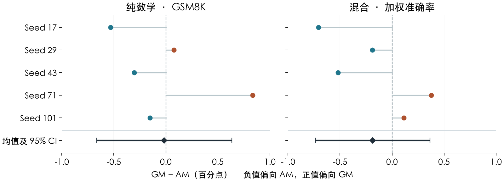

### 种子之间的差异

| Seed | 环境 | 共同轮数 | AM（%） | GM（%） | GM−AM（百分点） |
| ---: | --- | ---: | ---: | ---: | ---: |
| 17 | 纯数学 | 36 | 93.8590 | 93.3283 | -0.5307 |
| 17 | 混合 | 40 | 93.4626 | 92.7547 | -0.7079 |
| 29 | 纯数学 | 68 | 94.5413 | 94.6171 | +0.0758 |
| 29 | 混合 | 79 | 93.9777 | 93.7875 | -0.1902 |
| 43 | 纯数学 | 60 | 94.8446 | 94.5413 | -0.3033 |
| 43 | 混合 | 70 | 94.0360 | 93.5168 | -0.5192 |
| 71 | 纯数学 | 60 | 93.7074 | 94.5413 | +0.8340 |
| 71 | 混合 | 60 | 93.2208 | 93.5969 | +0.3761 |
| 101 | 纯数学 | 50 | 94.0106 | 93.8590 | -0.1516 |
| 101 | 混合 | 30 | 92.0844 | 92.1972 | +0.1127 |

单独去除采用旧训练后端的 seed17，纯数学的均差变为 **+0.114** 点，方向反转；混合变为 **−0.055** 点。混合任务逐一删去任意一个种子，四种子均差均偏 AM（−0.326 至 −0.055 点）。这说明混合结果的方向对单个种子较稳，但效应大小对运行条件敏感。

**任务混合是否改变了算法优劣？** 对每个 seed 再计算“混合均差 − 纯数均差”，平均 −0.171 点，95% 区间 [−0.501, +0.160]。两个主指标的权重不同；若只比较同一 GSM8K 测试集，这个差中之差为 −0.379 点，区间 [−0.948, +0.190]。两个探索性对比都允许效应跨零。训练数据的组成、数学题暴露量与早停轮数同时变化，无法把差异单独归因于任务多样性。

## 为什么会出现这样的结果

### 最初的数学直觉成立到哪一步

原方案同时改变训练环境，并把算法差异限定在回答内部的聚合算子上。这允许检验两件不同的事：单条回答的概率比如何变化，以及这种变化能否提高最终准确率。[原方案 §5、§8](docs/experiment_plan.md) · [实际目标函数](src/objectives.py)

设有效回答长度为 $L$，第 $t$ 个 token 的对数概率变化为 $d_t=\log(\pi_\theta/\pi_{old})$。写 $\bar d=L^{-1}\sum_t d_t$，两种序列比为

$$
s_{AM}=L^{-1}\sum_t e^{d_t},\qquad s_{GM}=e^{\bar d},\qquad
\log(s_{AM}/s_{GM})=\log\left(L^{-1}\sum_t e^{d_t-\bar d}\right)\geq 0.
$$

最后一项由 Jensen 不等式得到。token 变化相同，两种比率就相等。变化围绕均值且幅度小时，对中心化项展开，领先项为回答内 $d_t$ 方差的一半。比如两个 token 的概率比分别为 0.8 和 1.2，AM 为 1，GM 为 √0.96 ≈ 0.9798。保持平均概率比相同，增大 token 间的分散程度，就能拉开两种算子的值。

从生成过程看，整条回答的新旧策略似然比是各 token 比率的乘积，GM 正是这个乘积的 $L$ 次方根。若只有一个 token 的比率从 1 降为 0.1，其他 99 个都为 1，则 AM 为 0.991，GM 约为 0.9772。GM 对这个低概率 token 的惩罚更重，也因长度归一化而受到稀释。这给出了“关注一条推理链中薄弱环节”的精确定义。概率比下降可能出现在关键推理步骤、格式标记或无关措辞；实验的二元终局奖励没有标注是哪类 token。

**更大的序列比为何没有带来稳定的分数优势？** 在同一冻结回答、优势 $A$ 和未触发裁剪的条件下，两种代理目标的差恰为 $A(s_{AM}-s_{GM})$。正优势回答有利于 AM 的目标值，负优势回答则方向相反。每题 8 个回答的标准化优势均值为零，因此这一项的组内平均取决于**优势与两种比率差的协方差**。仅知道 AM≥GM，无法确定协方差符号。梯度的分配也不同：对 $d_t$ 求导，$\partial\log s_{AM}/\partial d_t=e^{d_t}/\sum_j e^{d_j}$，而 $\partial\log s_{GM}/\partial d_t=1/L$。更新刚开始、所有 $d_t=0$ 时，两者的值和一阶梯度相同。随后 AM 给概率比上升更多的 token 更大权重，最终效果还取决于这些 token 出现在哪些回答、其参数梯度如何叠加。

**日志约束了可能解释。** 按每个运行先取逐轮中位数，再对五个种子取中位数，四种环境与方法组合的 log(AM/GM) 约为 0.00056–0.00070，零优势组比例约 90.6%–92.2%。奖励只有对/错；一题的 8 个回答全对或全错时，这题的奖励项梯度为零，参考 KL 项仍参与优化。各运行记录的逐轮越过序列裁剪界限比例，峰值为数学 AM 0.1953%、混合 AM 0.0977%，两环境的 GM 均为 0。小概率比差、大量零优势组和罕见的越界，共同支持“两种目标在多数记录中提供相近奖励信号”这一解释。逐轮均值无法还原逐回答的优势与比率差协方差，也无法识别梯度方向是否被少数 token 改变。冻结同批回答的反事实梯度诊断在本次归档中没有直接测量。

### 混合组的差距具体来自哪里

| 混合训练后的测试分项 | GM−AM 平均准确率差（百分点） | 主指标权重 | 对平均总差的贡献（百分点） |
|---|---:|---:|---:|
| GSM8K | −0.3942 | 0.50 | −0.1971 |
| ARC-Easy | −0.1684 | 0.25 | −0.0421 |
| BoolQ | +0.2141 | 0.25 | +0.0535 |
| **加权合计** | | **1.00** | **−0.1857** |

混合主指标偏向 AM，最直接的来源是 GSM8K 的半数权重。BoolQ 上 GM 的优势抵消了一部分差距。这里的几何平均只作用于一条回答的 token，各任务之间没有几何聚合或最弱任务约束，所以训练目标本身不保证多任务均衡。

纯数学训练后，还有一个值得保留的**迁移现象**。在没有用 ARC-Easy 训练的条件下，GM 的 ARC-Easy 准确率均值比 AM 高 **5.522 点**（4/5 个种子为正，单个差值从 −0.210 到 +14.773 点）。按严格最终答案解析，正确率等于合法答案率 $v$ 乘合法答案中的正确率 $c$。将每对种子的差精确写成 $\bar c\,\Delta v+\bar v\,\Delta c$，横线取两种方法的算术平均。五对平均后，合法答案率项贡献 **+5.599 点**，条件正确率项贡献 **−0.077 点**。该分解定位了计分差异主要落在“是否产出可解析选项”上。它属于探索性转移诊断，不能据此推断 GM 改善了科学推理能力，也不能把两项差值解释为训练的因果中介效应。

## 结果图与逐运行记录

每张五种子图按行排列 seed，按列排列纯数学与混合环境。蓝色实线为 AM，橙色虚线为 GM。验证图含初始、每十轮及末轮的观测，曲线末端由各自的共同停止轮次决定。

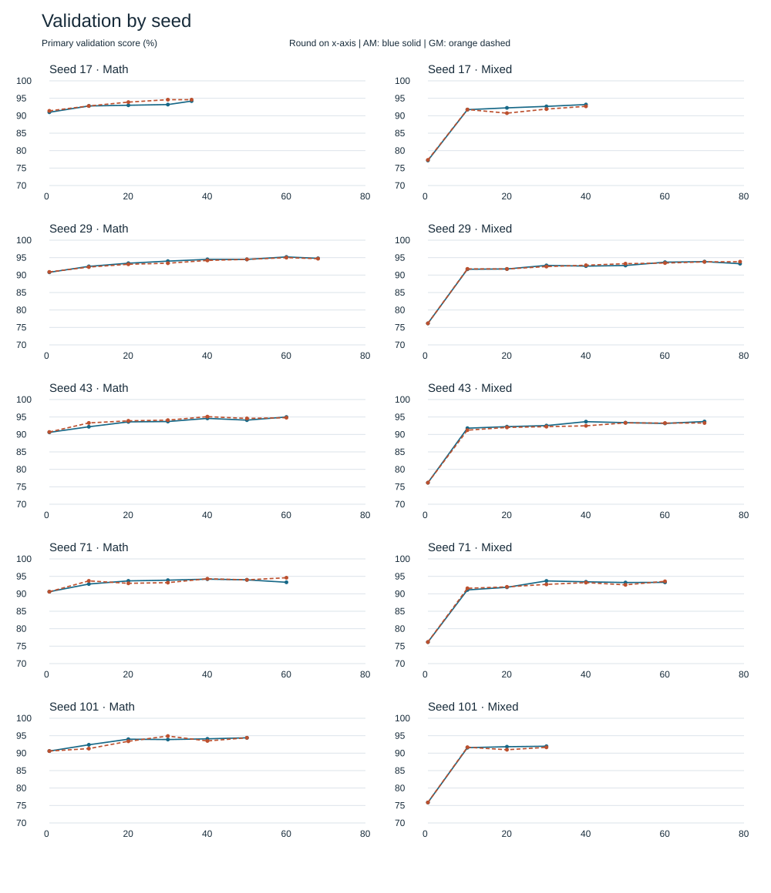

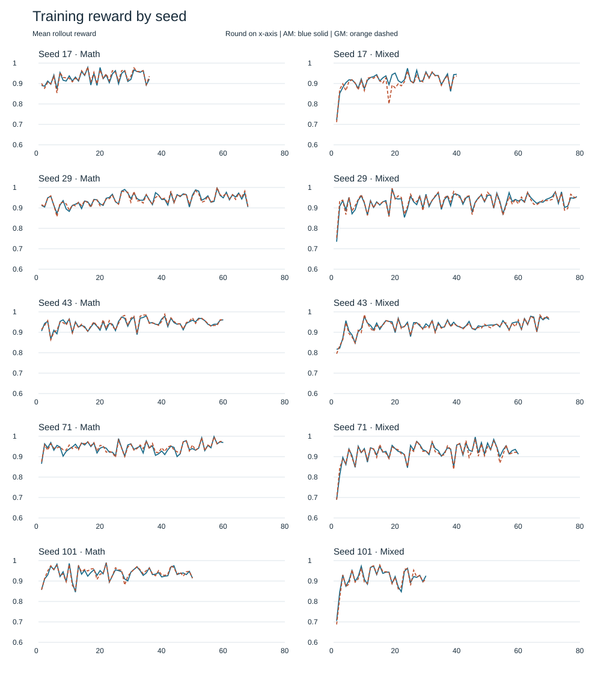

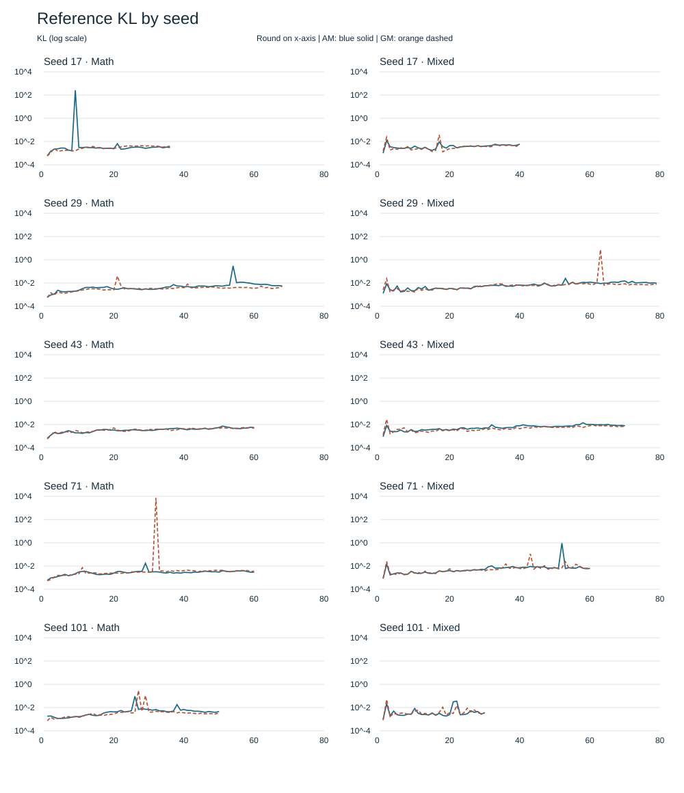

最大的 KL 峰值在 seed71 数学 GM 第32轮（7,359.61），另一明显峰值在 seed17 数学 AM 第9轮（258.71）。参考 KL 比较当前策略与初始参考策略，裁剪使用当前策略与行为策略的比率。两者的参照不同，因此罕见裁剪与大 KL 峰值可以同时出现。峰值出现在两个方法中，单凭最大值也无法解释哪组的最终准确率较高。

| Seed | 环境 | 方法 | 轮数 | 峰值KL | 同轮损失 |
| ---: | --- | --- | ---: | ---: | ---: |
| 71 | 纯数学 | GM | 32 | 7359.61 | 73.596 |
| 17 | 纯数学 | AM | 9 | 258.712 | 2.58693 |
| 29 | 混合 | GM | 63 | 7.45449 | 0.0745288 |
| 71 | 混合 | AM | 52 | 0.941915 | 0.00921025 |
| 29 | 纯数学 | AM | 54 | 0.297253 | 0.00290974 |


<details>
<summary>展开首个种子 seed17 的八张原始诊断图</summary>

**主验证分数**

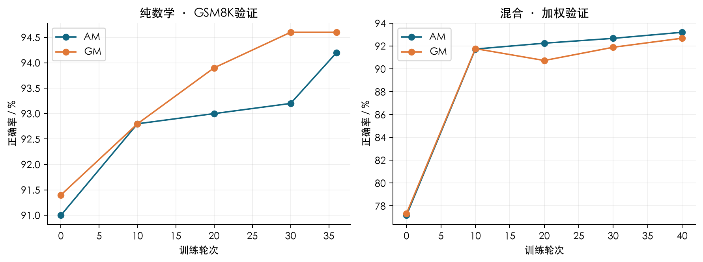

**采样奖励与零优势组**

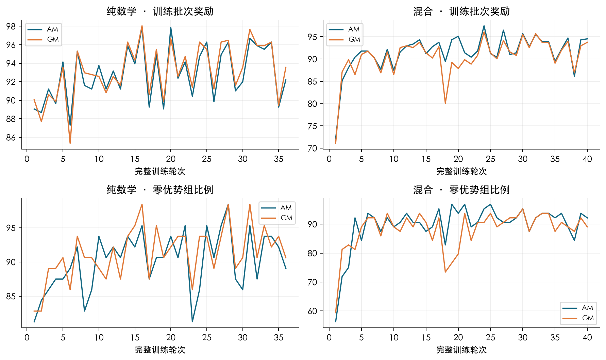

**聚合差距与裁剪**

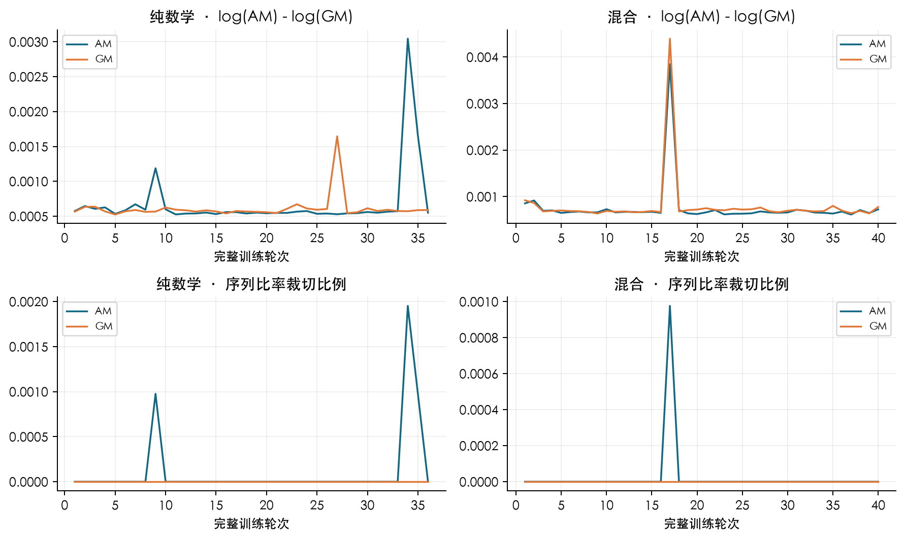

**参考 KL**

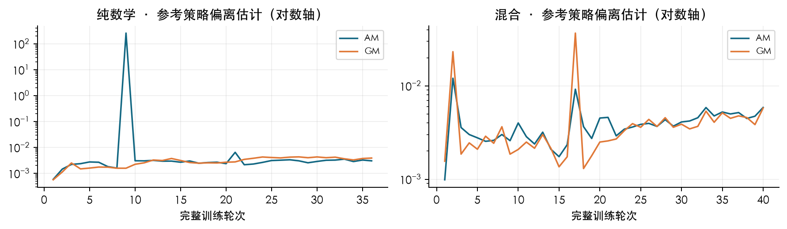

**总损失**

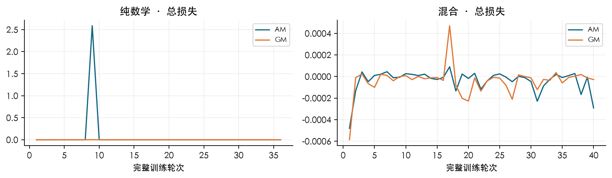

**混合 ARC-Easy 准确率与合法答案率**

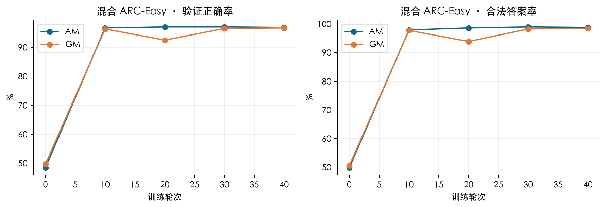

**平均回答长度**

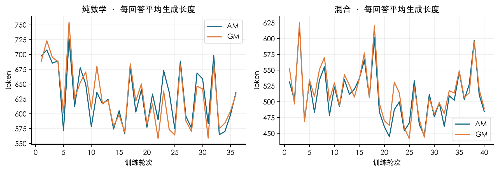

**合法输出与截断率**

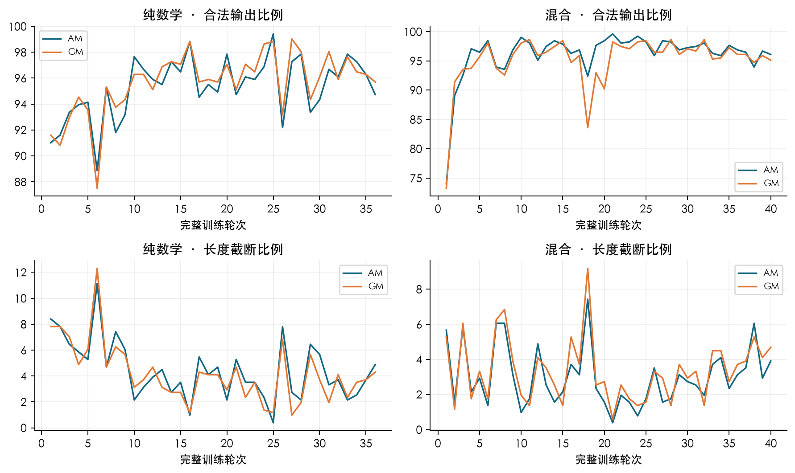

</details>

<details>
<summary>展开 20 组锁定测试的逐任务分数</summary>

每行是一个独立训练运行。宏平均给三个测试集相同权重。纯数学主指标和混合主指标分别按前文定义。

| Seed | 训练环境 | 方法 | GSM8K % | ARC-Easy % | BoolQ % | 宏平均 % | 主指标 % |
|---:|---|---|---:|---:|---:|---:|---:|
| 17 | 纯数学 | AM | 93.859 | 69.066 | 85.046 | 82.657 | 93.859 |
| 17 | 纯数学 | GM | 93.328 | 73.822 | 85.535 | 84.228 | 93.328 |
| 17 | 混合 | AM | 93.252 | 98.232 | 89.113 | 93.533 | 93.463 |
| 17 | 混合 | GM | 92.039 | 97.980 | 88.960 | 92.993 | 92.755 |
| 29 | 纯数学 | AM | 94.541 | 71.633 | 86.575 | 84.250 | 94.541 |
| 29 | 纯数学 | GM | 94.617 | 71.423 | 85.749 | 83.930 | 94.617 |
| 29 | 混合 | AM | 93.935 | 98.316 | 89.725 | 93.992 | 93.978 |
| 29 | 混合 | GM | 93.707 | 98.316 | 89.419 | 93.814 | 93.788 |
| 43 | 纯数学 | AM | 94.845 | 71.170 | 84.220 | 83.412 | 94.845 |
| 43 | 纯数学 | GM | 94.541 | 85.943 | 86.391 | 88.959 | 94.541 |
| 43 | 混合 | AM | 93.935 | 98.274 | 90.000 | 94.070 | 94.036 |
| 43 | 混合 | GM | 93.101 | 98.232 | 89.633 | 93.655 | 93.517 |
| 71 | 纯数学 | AM | 93.707 | 74.621 | 85.107 | 84.479 | 93.707 |
| 71 | 纯数学 | GM | 94.541 | 79.630 | 85.535 | 86.569 | 94.541 |
| 71 | 混合 | AM | 93.252 | 98.274 | 88.104 | 93.210 | 93.221 |
| 71 | 混合 | GM | 93.328 | 97.854 | 89.878 | 93.686 | 93.597 |
| 101 | 纯数学 | AM | 94.011 | 73.274 | 84.954 | 84.080 | 94.011 |
| 101 | 纯数学 | GM | 93.859 | 76.557 | 84.832 | 85.083 | 93.859 |
| 101 | 混合 | AM | 91.660 | 97.769 | 87.248 | 92.226 | 92.084 |
| 101 | 混合 | GM | 91.888 | 97.643 | 87.370 | 92.300 | 92.197 |

</details>

## 训练规模与算力

| Seed | H20 GPU 小时 | 训练输出 | 验证输出 | 测试输出 | 按回答计输入 | 逻辑合计 | CPU验收（北京时间） |
| ---: | ---: | ---: | ---: | ---: | ---: | ---: | --- |
| 17 | 53.037 | 44,192,411 | 22,810,118 | 10,396,490 | 17,715,052 | 95,114,071 | 11-16 14:00:44 |
| 29 | 49.499 | 83,931,566 | 38,280,848 | 10,257,718 | 29,575,140 | 162,045,272 | 11-17 03:13:32 |
| 43 | 47.307 | 74,624,796 | 34,010,995 | 10,404,395 | 26,557,860 | 145,598,046 | 11-17 15:33:32 |
| 71 | 41.752 | 70,438,976 | 31,691,788 | 10,496,614 | 24,829,276 | 137,456,654 | 11-18 03:38:59 |
| 101 | 31.397 | 49,174,073 | 23,207,615 | 10,813,370 | 17,954,892 | 101,149,950 | 11-18 14:11:39 |

合计 **222.991 H20 GPU小时，641,363,993 个逻辑 token**，其中输出 524,731,773。GPU小时按每组占用一张H20的运行墙钟相加，含初始验证和最终测试。按每个 prompt 计一次的输入共 65,260,158，GPU实际缓存命中、prefill计算量与重复前反向 token 未测。单组墙钟范围为5.799至13.383小时。训练使用同一台阿里云PAI节点的GPU0至GPU3，每组单卡。节点可见8张H20、184核CPU和1800GiB cgroup内存，模型、数据和完整证据留在CPFS。

## 复现与证据

- 两个训练环境各 6,000 个唯一题目。纯数学使用 GSM8K，混合使用 3,000 道 GSM8K、1,500 道 ARC-Easy、1,500 道 BoolQ。每轮 64 题、每题 8 个回答、2 个优化 epoch、16 次 AdamW 更新。实际共 **1,106 个运行轮次、566,272 条采样回答、17,696 次更新**。
- 四个条件均从官方 Qwen3-8B 独立初始化，使用 BF16 LoRA、thinking，训练温度 1、top-p 1，最终测试为贪心生成。每对用相同题序、配对早停和最后共同检查点。每组 6,965 题锁定测试含 GSM8K 1,319、ARC-Easy 2,376、BoolQ 3,270。每题按统一的最终答案规则计分。[训练协议](docs/experiment_plan.md) · [评分代码](src/rewards.py)
- 每10轮验证、至少20轮、双方连续两次未达到0.5个百分点改善时成对早停，另有每对12小时软上限。seed71 数学 AM 在第40轮从 0.937 到 0.942，原浮点计算的门槛为 0.9420000000000001，计数未重置。保留实际发生的训练暴露和停止决定。[实现与后端选择](docs/method_decision.md) · [提速实测](docs/efficiency-v4.md) · [提速 Skill](skills/inference-training-acceleration/SKILL.md)
- [逐轮数据与来源哈希](reports/five-seed-curve-data.json) · [资源与配对统计](reports/five-seed-summary.json) · [五种子汇报](reports/five-seed-results.md) · [首个种子 PDF](output/pdf/GRPO首seed实验详报_黑体_20261116.pdf)
- 单种子报告：[17](reports/seed17-results.md) · [29](reports/seed29-results.md) · [43](reports/seed43-results.md) · [71](reports/seed71-results.md) · [101](reports/seed101-results.md)

## 运行

实现采用Transformers/PEFT训练及vLLM单卡rollout。PAI模型为 `/mount-data/Models/Qwen3-8B`，配置为 `configs/pai-seed17.json`，工作根 `/mount-data/GRPO-Sequence-Ratio`。软件及共同配置见[实施决策](docs/method_decision.md)，测试见[TEST.md](TEST.md)。

```sh
export PYTHONPATH="$PWD"
export USE_TF=0 USE_FLAX=0
python -m unittest discover -s tests -v
HF_ENDPOINT=https://hf-mirror.com python -m src.data --output /mount-data/Datasets/GRPO-Sequence-Ratio/data-v1 --source-manifest reports/data-manifest.json
python scripts/run_seed.py --config configs/pai-seed17.json --output /mount-data/GRPO-Sequence-Ratio/runs/seed17 --phase formal --parallel-environments
```
